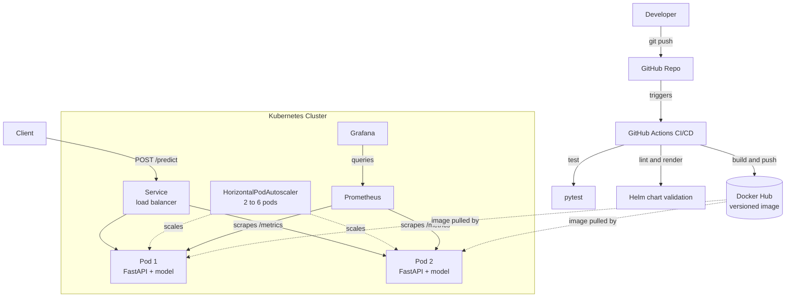
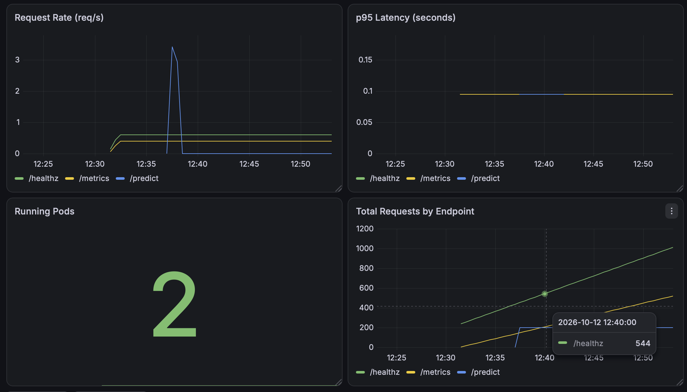

# ML Model-Serving Platform on Kubernetes

A production-style platform for serving a machine-learning model as a scalable,
self-healing, observable web service. Built with FastAPI, Docker, Kubernetes,
Helm, GitHub Actions CI/CD, and Prometheus + Grafana.

The ML model itself (a lightweight sentiment classifier) is intentionally simple.
The focus of this project is the **platform**: how a model gets packaged, deployed,
scaled, monitored, and shipped reliably — the model is swappable without changing
any of the surrounding infrastructure.

---

## Architecture



---

## Features

- **Containerized ML service** — FastAPI app serving model predictions, packaged in Docker
- **Kubernetes orchestration** — 2 replicas with liveness/readiness probes for self-healing and zero-downtime rollouts
- **Autoscaling** — HorizontalPodAutoscaler scales 2 to 6 pods based on CPU utilization
- **Helm packaging** — single-command deploy, upgrade, and instant rollback
- **CI/CD pipeline** — GitHub Actions runs tests, builds and pushes a versioned image to Docker Hub, and validates the Helm chart on every push
- **Observability** — Prometheus scrapes application metrics; Grafana dashboard tracks request rate, p95 latency, running pods, and request totals

---

## Security & Multi-Tenancy

The platform runs as an isolated multi-tenant system with authenticated,
secret-managed access.

**Multi-tenant isolation** — the same Helm chart is deployed into per-tenant
namespaces (`tenant-a`, `tenant-b`), each independently sandboxed:

| Isolation layer | Mechanism | Verified by |
|---|---|---|
| Compute | `ResourceQuota` caps CPU / memory / pod count per namespace | quota rejects pods that omit resource limits |
| Network | Calico `NetworkPolicy` (default-deny + same-namespace allow) | cross-tenant request returns `404` before the policy, times out after |

> Network enforcement requires a CNI that honors NetworkPolicies; the cluster
> is created with Calico (`disableDefaultCNI: true`) for this reason.

**API authentication** — `/predict` requires a valid `X-API-Key` header and
returns `401` otherwise. Probes (`/healthz`) and metrics (`/metrics`) stay open
so Kubernetes and Prometheus keep working.

**Secrets management** — the valid key is stored in a Kubernetes `Secret` and
injected into the container as the `API_KEY` environment variable at runtime.
It is never committed to the repo or baked into the image.

```bash
# Rejected: no key
curl -s -o /dev/null -w "%{http_code}\n" -X POST http://localhost:8080/predict \
  -H "Content-Type: application/json" -d '{"text":"great"}'
# 401

# Allowed: valid key from the Secret
curl -X POST http://localhost:8080/predict \
  -H "Content-Type: application/json" \
  -H "X-API-Key: $MY_API_KEY" \
  -d '{"text":"great"}'
# {"sentiment":"positive","confidence":0.5}
```

---

## Tech Stack

| Layer | Technology |
|---|---|
| API | FastAPI, Uvicorn |
| Model | scikit-learn |
| Container | Docker |
| Orchestration | Kubernetes (kind for local) |
| Packaging | Helm |
| CI/CD | GitHub Actions |
| Registry | Docker Hub |
| Monitoring | Prometheus, Grafana |

---

## API Endpoints

| Method | Path | Description |
|---|---|---|
| GET | `/healthz` | Health check (used by Kubernetes probes) |
| POST | `/predict` | Returns sentiment + confidence for input text |
| GET | `/metrics` | Prometheus-format metrics |

Example:

```bash
curl -X POST http://localhost:8080/predict \
  -H "Content-Type: application/json" \
  -d '{"text": "this platform is great"}'
# {"sentiment":"positive","confidence":0.5}
```

---

## Container Image

Published automatically by CI/CD to Docker Hub:

```
docker pull budhilsai19/sentiment-api:latest
```

---

## Monitoring Dashboard

Grafana dashboard tracking request rate, p95 latency, running pods, and request totals:



---

## Local Setup

See [RUNBOOK.md](./RUNBOOK.md) for full operational instructions (cluster creation,
deploy, scaling demo, rollback, and monitoring access).

---

## Project Structure

```
ml-serving-platform/
├── app/                      # FastAPI application + model
│   ├── main.py               # API with /predict, /healthz, /metrics
│   ├── train.py              # Trains and saves the model
│   └── model.joblib          # Trained model artifact
├── tests/                    # pytest API tests
├── k8s/                      # Kubernetes manifests + ServiceMonitor + dashboard
├── sentiment-chart/          # Helm chart
├── .github/workflows/ci.yml  # CI/CD pipeline
├── Dockerfile
└── requirements.txt
```

---

## Possible Extensions

- Multi-architecture image builds (arm64 + amd64) via Docker Buildx
- Model registry (MLflow) instead of committing the model artifact
- Continuous deployment to a managed cloud cluster (GKE/EKS)
- Distributed serving with Ray Serve + load/chaos testing
